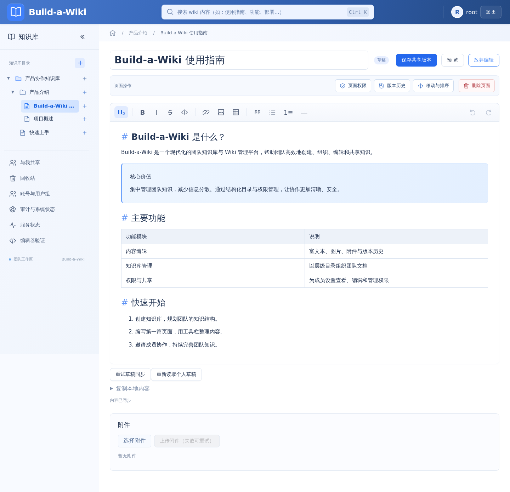

# Build-a-Wiki

Build-a-Wiki 是一个支持私有部署的中文团队知识库，提供分层页面、富文本编辑、版本历史和细粒度权限管理。适用于整理团队文档、操作手册和项目知识，支持通过 Docker 部署及离线安装。

## 主要功能

- **知识库与页面目录**：创建知识库、页面和子页面；支持目录展开收起、同库移动与排序，移动后页面地址保持不变。
- **富文本编辑**：支持标题、列表、引用、代码块、表格、图片和附件链接，可在编辑与预览之间切换。在行首输入 `- [ ]` 或 `- [x]` 后按空格，可分别创建未完成或已完成的待办项。
- **个人草稿与页面保存**：每篇文稿同时只允许一个窗口编辑。断线时暂停编辑并保留本地草稿。编辑内容自动保存为个人草稿，点击“保存”生成新版本，有查看权限的成员即可阅读。版本冲突时保留本地内容。
- **版本历史**：查看历史正文并恢复为新版本，保留已有历史记录。
- **账号与权限**：管理用户和用户组，按知识库或页面授予查看、编辑和管理权限；页面支持继承权限或独立授权。
- **内容查找**：支持全局搜索、人员筛选、最近访问和“与我共享”入口。
- **附件与回收站**：上传和下载附件，附件访问遵循页面权限；删除前预览影响范围，删除后可通过回收站恢复。
- **审计与系统状态**：查看操作日志、维护模式、后台任务及附件磁盘可用空间，支持手动重试任务。
- **响应式界面**：适配桌面、平板和手机，支持键盘操作及减少动态效果设置。



## 技术栈

| 层级 | 技术 |
| --- | --- |
| 前端 | React、TypeScript、Vite、Ant Design、Tiptap |
| 后端 | Rust、Axum、Tokio、SQLx |
| 数据库 | PostgreSQL |
| 部署 | Docker Compose、Nginx、HTTPS |

工具链版本见 [dependency.txt](dependency.txt) 和 [工具链说明](docs/TOOLCHAIN.md)。

## 本地运行

以下步骤适用于 Ubuntu 22.04 或相应 WSL 环境。请先安装 Node.js、npm 和 Rust，并确保 `cargo` 在 `PATH` 中。所有命令均从仓库根目录执行，另有说明的除外。

### 1. 准备数据库和环境配置

```bash
sudo apt-get install build-essential pkg-config libssl-dev postgresql-14 postgresql-client-14
sudo bash scripts/dev-db.sh
cp .env.example .env

export PATH="$HOME/.cargo/bin:$PATH"
set -a
source .env
set +a
mkdir -p .data/attachments

(cd frontend && npm ci)
make migrate
```

`.env.example` 中的数据库凭据仅用于本机开发。已有 `.env` 时直接检查配置，无需覆盖。数据库迁移需在启动后端前执行；已有实例升级时也应先应用迁移。

### 2. 初始化管理员

首次运行时，将至少 12 个字符的管理员密码存入权限为 `600` 的本地文件，再执行：

```bash
cargo run --locked --manifest-path backend/Cargo.toml --bin bootstrap -- admin < /path/to/password-file
```

初始化仅允许成功一次。已有账号的实例无需重复执行，登录后可在账号管理界面添加用户。

### 3. 启动服务

完成上述准备后，一条命令即可在两个终端分别启动后端和前端：

```bash
./scripts/dev-start.sh
```

在 WSL 中，脚本优先打开一个 Windows Terminal 窗口和两个标签页；在 tmux 中或没有 Windows Terminal 时，使用两个 tmux 窗口。每个服务的日志显示在对应终端，按 `Ctrl+C` 可单独停止。

如需手动启动，后端终端需先加载根目录的 `.env`：

```bash
set -a
source .env
set +a
cargo run --locked --manifest-path backend/Cargo.toml --bin wiki-api
```

在另一个终端启动前端：

```bash
cd frontend
npm run dev
```

浏览器访问 **http://127.0.0.1:5173**。前端开发服务将 API 请求转发至后端 `8080` 端口。WSL 环境下可通过 Windows 浏览器访问同一地址。

本机测试时可在 `frontend/.env.development.local` 中设置 `WIKI_TEST_ADMIN_PASSWORD` 为开发库 `admin` 账号的密码。打开 `http://127.0.0.1:5173` 即可点击登录；移除该配置并重启前端即可恢复账号密码表单。

后端就绪检查：

```bash
curl http://127.0.0.1:8080/health/ready
```

## 部署与运维

支持 Docker Compose 和离线镜像包部署。正式部署需要配置 HTTPS、数据库凭据、附件存储和备份策略，具体步骤见 [安装与运维手册](docs/OPERATIONS.md)。手册还包含账号管理、备份恢复、维护模式及故障诊断说明。

## 测试

加载 `.env` 后运行：

```bash
make check
```

该命令检查前端类型、格式、测试与构建，执行 Rust 检查和测试，并验证 API 契约。数据库测试使用 `TEST_DATABASE_URL` 指定的测试库，不应指向业务数据库。

浏览器测试：

```bash
(cd frontend && npx playwright install --with-deps chromium)
cargo build --locked --manifest-path backend/Cargo.toml
python3 scripts/e2e.py
```

浏览器测试脚本创建隔离的数据和临时服务，成功后清理；失败时保留测试 schema 和诊断记录。

## 相关文档

- [安装、部署与运维](docs/OPERATIONS.md)
- [身份认证与权限规则](docs/IDENTITY.md)
- [富文本内容格式](docs/BODY_SCHEMA.md)
- [OpenAPI 接口定义](docs/openapi.json)
- [依赖与许可证清单](docs/licenses.json)
