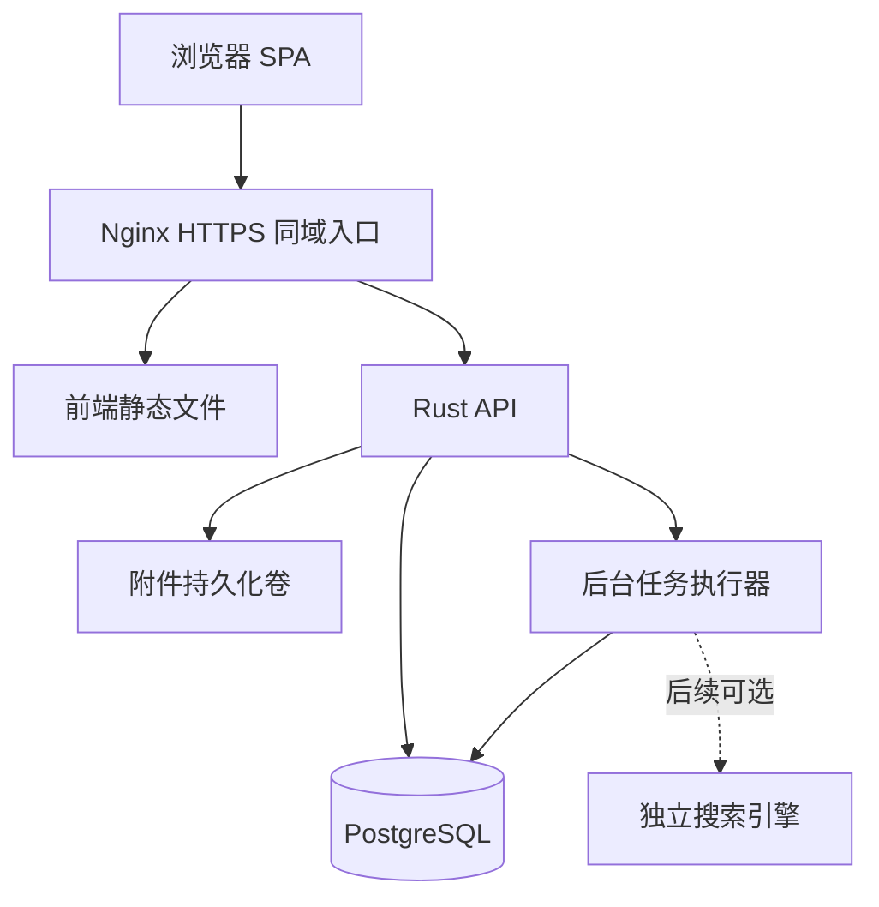

# 团队 Wiki 系统详细设计稿

版本：v0.1 · 日期：2026-11-16 · 状态：待实现的设计基线

## 1. 目标与设计边界

构建可在局域网独立运行的中文团队知识管理系统。每位启用账号的成员可创建多个知识库，在知识库内创建任意层级的页面；知识库和页面均可单独授权多人协作。支持标题、正文以及创建者、历史贡献者、授权协作者筛选。

本稿采用 TypeScript + React 前端、Rust 后端、PostgreSQL 数据库。它是新项目设计，不是对现有 XWiki 的改造，也不假定能够直接复用其数据库。

初期容量规划假设：100 名注册用户、20 人同时在线、10 万篇页面、20 GB 附件。以上是测试目标，不是已测得的性能保证。部署初期为单实例，允许维护时短暂停机。

### 1.1 第一阶段交付范围

- 账号登录、退出、账号停用与用户组管理。
- 每人创建知识库，管理知识库成员与访问权限。
- 页面树、富文本编辑、页面移动、回收站。
- 页面独立授权、父级权限继承和权限预览。
- 自动保存个人草稿、显式保存共享版本、冲突检测与版本恢复。
- 图片和附件上传、受控下载。
- 标题/正文关键词匹配，按知识库及人员关系筛选。
- 审计日志、备份恢复、离线部署说明。

### 1.2 后续范围

- 中文分词、相关性排序及独立搜索引擎。
- 同一篇文档实时协同编辑。
- LDAP/AD 或 OIDC 企业身份接入。
- 评论、通知、模板、导入导出。

第一阶段不包含匿名访问、公开分享链接、复杂审批流、AI 问答、附件正文 OCR 与 Office 文档协同编辑。

## 2. 产品结构与页面设计

### 2.1 信息结构

```text
团队工作区
├── 我的知识库
│   ├── 研发手册
│   │   ├── 项目 A（自身也可以有正文）
│   │   │   ├── 系统设计
│   │   │   └── 部署说明
│   │   └── 编码规范
│   └── 个人笔记
└── 与我共享
    └── 其他成员授予我访问权限的知识库或页面
```

知识库是内容和管理边界，页面是树节点。页面 URL 使用不可变 UUID，标题修改和树内移动不改变链接。首版不跨知识库移动页面，避免隐式迁移附件、成员与权限。

### 2.2 主要界面

| 界面 | 核心内容 | 操作 |
| --- | --- | --- |
| 首页 | 最近访问、我的知识库、与我共享 | 建库、搜索、打开页面 |
| 知识库 | 左侧页面树，右侧概览或页面正文 | 新建页面、展开目录、管理成员 |
| 页面阅读 | 标题、作者、更新时间、正文、面包屑 | 编辑、历史版本、权限、移动、删除 |
| 页面编辑 | 富文本工具栏、目录、保存状态 | 保存、放弃草稿、预览 |
| 权限面板 | 当前有效权限、来源、直接授权 | 继承/独立切换、添加用户/组、保存 |
| 搜索页 | 关键词、范围、匹配位置、人员及关系 | 筛选、分页、跳转 |
| 管理后台 | 用户、组、审计、系统状态 | 停用账号、调整成员、查看任务 |

所有自有界面默认简体中文；语言资源集中管理，为后续多语言留出接口。空状态、加载中、无权限、冲突、上传失败均需要明确提示。

### 2.3 页面交互规则

- 目录树按需加载子节点，不一次返回整棵树；支持显式排序。
- 删除父页面时显示受影响的子页面数量，确认后整棵子树进入回收站。
- 无权限页面直接访问返回统一的不存在提示，避免泄露资源存在性。
- 同一知识库中无权访问的祖先标题不显示；可访问的独立子页面出现在“与我共享”中，面包屑从可见节点开始。
- 编辑器首版支持段落、标题、列表、引用、代码块、表格、链接、图片；不允许任意脚本或原始 HTML 执行。

## 3. 技术选型与部署架构

| 层 | 选择 | 说明 |
| --- | --- | --- |
| 前端 | TypeScript、React、Vite | 内网 SPA，无 SEO 和 SSR 需求 |
| 组件 | Ant Design | 目录、权限表、表单等管理界面 |
| 请求状态 | TanStack Query | 缓存、失效、分页与重试 |
| 路由 | React Router | 页面及管理模块导航 |
| 编辑器 | Tiptap | JSON 正文模型；具体扩展逐项核对许可证 |
| API | Rust、Axum、Tokio | 模块化单体服务 |
| 数据访问 | SQLx | SQL 查询、事务、迁移 |
| 存储 | PostgreSQL | 唯一业务事实来源 |
| 附件 | 本地持久化卷 | 接口抽象，后续可替换对象存储 |
| 入口 | Nginx | 静态文件、反向代理、HTTPS |
| 部署 | Docker Compose | 单机部署与环境复现 |

依赖版本在项目初始化时根据官方兼容性说明确定并锁定；提交前端 lockfile、Cargo.lock 和容器镜像版本，不使用浮动 latest 标签。



开发可使用 Vite 代理 `/api`；部署时所有接口与静态资源同域。业务只通过 Rust API 访问数据库，前端不连接数据库或搜索管理接口。首版不需要 Redis、消息队列和 Kubernetes。

## 4. 模块职责与工程布局

```text
build-A-wiki/
├── frontend/src/
│   ├── app/                  路由、全局布局、初始化
│   ├── features/             auth、knowledge、pages、search、admin
│   ├── components/           通用控件和编辑器封装
│   ├── api/                  由 OpenAPI 生成的类型及调用封装
│   └── locales/              中文语言资源
├── backend/
│   ├── src/
│   │   ├── routes/           HTTP 参数解析与响应
│   │   ├── services/         业务流程与事务边界
│   │   ├── permissions/      唯一权限计算实现
│   │   ├── repositories/     SQL 与持久化
│   │   ├── jobs/             清理、派生数据和索引任务
│   │   └── infrastructure/   配置、会话、文件、日志
│   ├── migrations/
│   └── tests/
├── deploy/                   Compose、Nginx、配置样例
├── scripts/                  开发、备份与恢复脚本
└── docs/                     API、运维、验收说明
```

HTTP 层不直接拼接权限 SQL。业务服务先确定资源和操作者，再通过统一权限服务计算权限，写操作在事务内完成授权复核和变更。

## 5. 数据模型

所有主键使用 UUID；时间使用 UTC `timestamptz`，前端按用户时区展示；下表省略常规创建和更新时间字段。UUID 不作为权限保护手段。

| 表 | 关键字段与约束 |
| --- | --- |
| users | id、username 唯一、display_name、password_hash、status |
| groups | id、name 唯一 |
| group_members | group_id、user_id，组合唯一；首版无嵌套组 |
| sessions | id、token_hash、user_id、expires_at、last_seen_at |
| knowledge_bases | id、name、owner_id、acl_version、deleted_at |
| pages | id、knowledge_base_id、parent_id、title、position、current_revision_id、acl_mode、lock_version、deleted_at、deletion_batch_id |
| page_revisions | id、page_id、revision_no、body_json、body_text、editor_id、summary、restored_from_revision_id、created_at；page_id + revision_no 唯一 |
| page_drafts | page_id、user_id、base_revision_id、body_json、updated_at；page_id + user_id 唯一 |
| permission_entries | resource_type、resource_id、subject_type、subject_id、role；资源与授权对象组合唯一 |
| attachments | id、page_id、storage_key 唯一、original_name、mime_type、size、checksum、uploader_id、status |
| audit_events | actor_id、action、resource_type、resource_id、request_id、details、created_at |
| outbox_events | id、event_type、aggregate_id、payload、attempts、available_at、processed_at |

### 5.1 关键约束

- 页面父节点必须属于同一知识库。通过组合外键或等效数据库约束保证，不能只依赖前端。
- 当前版本必须属于当前页面，版本正文不可原地修改。
- 创建者固定记录在页面上（增加 `created_by` 字段），不能从最近版本推断。
- `permission_entries` 的多态资源引用不能依赖普通外键直接保证；实现时优先拆为知识库 ACL 和页面 ACL 两张物理表，保留统一领域接口。
- 授权对象也优先采用分别可校验的用户/组外键，并要求二者恰有一个非空。
- 首版树结构采用邻接表和递归 CTE；只有测量证明需要时才增加闭包表。
- 移动操作锁定知识库行，并检查新父节点不在当前子树中，防止并发移动形成环。
- 目录递归设置可配置深度上限，建议初始 64 层，返回明确错误而非截断内容。

### 5.2 初始索引

- pages：`(knowledge_base_id, parent_id, position, id)`，未删除记录的部分索引。
- page_revisions：`(page_id, revision_no DESC)`、`(editor_id, page_id)`。
- pages：`(created_by, knowledge_base_id)`。
- group_members：`(user_id, group_id)`。
- ACL：资源维度和授权对象维度各一个索引。
- audit_events：`(created_at DESC, id)`、`(resource_type, resource_id, created_at)`。
- outbox_events：待处理记录按 available_at 的部分索引。

## 6. 权限模型

### 6.1 角色

| 能力 | 查看者 | 编辑者 | 管理员 |
| --- | --- | --- | --- |
| 查看页面、版本、附件 | 是 | 是 | 是 |
| 编辑正文、上传附件、创建子页面 | 否 | 是 | 是 |
| 删除与移动页面 | 否 | 否 | 是 |
| 修改权限 | 否 | 否 | 是 |
| 管理知识库成员及设置 | 否 | 否 | 仅知识库管理员 |

角色包含下级能力。知识库所有者不可被普通 ACL 移除，转让所有权必须是独立操作。系统管理员拥有明确的全局管理和访问能力，访问敏感内容同样写审计日志；不将系统管理员描述为无法查看私密内容。

### 6.2 继承算法

1. 账号停用或会话失效：拒绝。
2. 系统管理员或当前知识库所有者：授予管理权限。
3. 从当前页面向上寻找最近的 `acl_mode=independent` 节点。
4. 找到则只使用该节点 ACL；否则使用知识库 ACL。
5. 合并用户直接授权和所属用户组授权，采用最高角色；无匹配则拒绝。

首版不引入显式 deny，避免与组授权和继承组合产生难以解释的规则。独立授权是替换继承，不是叠加。页面管理员可以将页面设为独立授权，但不能借此获得知识库管理权限。

允许将子页面单独共享给无父页面访问权限的人；因此“能看知识库外壳”和“能看所有页面”不能等同。导航只返回可见信息，独立共享页面有独立入口。

### 6.3 权限变更一致性

- 修改 ACL、组成员、页面父节点均需要重新考虑有效权限。
- 首版数据库实时计算，不跨请求缓存完整授权结果；请求内可缓存。
- 写操作获取知识库锁后再次鉴权，防止撤权与保存并发产生越权提交。
- 组成员变更与写操作的竞态通过成员关系行锁或统一授权版本复核处理，具体锁顺序统一为用户/组、知识库、页面，避免死锁。
- 返回权限预览：当前角色、授权来源、是否继承；只有具有管理权限的人可查看完整成员名单。
- 普通用户不能通过“按协作者搜索”的人员选择器枚举敏感组信息。

## 7. 编辑、版本与附件

### 7.1 正文与保存

Tiptap JSON 为正文事实来源，记录 `schema_version`；后端校验节点类型、最大深度和大小。搜索纯文本由受控转换器生成，不能信任客户端提交的 body_text。首版正文上限建议 2 MB，可配置。

个人草稿自动保存，建议停止输入 2 秒后触发；草稿只对本人可见。共享内容仅在显式保存时生成版本。自动保存失败必须显示未同步状态，不得显示为已保存。

保存请求携带 `base_revision_id`。事务内锁定页面，重新鉴权并比较当前版本；不一致返回 409，保留客户端草稿并提供查看差异、复制内容和重新编辑入口。首版不静默自动合并富文本。

版本恢复生成新版本，记录来源版本；不回写历史记录。恢复正文时不会恢复旧权限或自动重新公开已删除附件。

### 7.2 附件

- 上传必须绑定已有页面并检查编辑权限；新页面先创建空页面后上传。
- 流式接收至临时文件，校验大小、类型后原子移动，以随机 storage_key 保存，原文件名仅用于展示。
- 初始单文件上限 50 MB，可配置；知识库配额后续增加。
- 数据库和文件系统之间使用 pending/ready 状态及定期清理任务处理失败，不假设跨系统事务。
- 下载、缩略图、历史版本附件均检查页面当前权限，不暴露无鉴权静态目录。
- 拒绝路径穿越；HTML/SVG 等主动内容默认以附件下载，不直接同源执行。
- 已软删除页面的附件普通接口不可访问，恢复页面后可重新访问。

### 7.3 回收站

删除操作为整棵子树赋同一个 deletion_batch_id；恢复只恢复该批次，不能误恢复此前已删除的子节点。父页面不存在时要求指定有权限的新父节点。默认保留 30 天，永久清理使用后台任务并记录审计。

## 8. 搜索设计

### 8.1 请求维度

`q`：关键词；`scope`：可选知识库；`fields`：title/body/all；`person_id`：人员；`relation`：creator/last_editor/contributor/editor_access；分页大小默认 20，上限 100。

人员条件必须以稳定用户 ID 过滤，显示名称可以重复或改变。历史贡献者指已保存共享版本的编辑者，不包括只写过个人草稿的人。授权协作者指当前有效角色至少为编辑者的人，不要求其实际编辑过。

### 8.2 第一阶段实现

- 使用参数化 SQL 的 ILIKE 子串匹配，明确转义 `%` 和 `_`，默认按普通文本处理。
- 搜索当前已保存版本，不搜索个人草稿和回收站。
- 在数据库查询内结合有效权限和人员条件，再排序分页，不能先 LIMIT 再过滤权限。
- 按标题命中优先、更新时间、UUID 稳定排序；第一阶段不宣传分词或智能相关性。
- 数量统计采用同一权限条件；性能不足时隐藏精确总数并提供“还有更多”，不展示未经鉴权的计数。
- 短词及中文子串搜索可能全表扫描，纳入容量测试；必要时评估 pg_trgm，但其效果需要结合词长和语料测试。

### 8.3 独立引擎阶段

通过真实中文语料比较搜索引擎的分词、标题权重、混合语言、拼音需求与运维成本，不在首版固定引擎。

页面保存和 outbox 事件同事务提交；任务执行器幂等更新索引，失败重试并支持全量重建。数据库仍是权限事实来源。搜索结果回传前必须复核当前权限，禁止直接把引擎的摘要、命中数、聚合或自动补全发给浏览器；通过继续拉取候选补足页面，必要时返回不精确分页。撤权后立即按数据库拒绝，即使索引尚未刷新。

## 9. API 契约

前缀 `/api/v1`，JSON 编码，OpenAPI 为接口文档与前端类型生成来源。以下为初稿，实施前固定请求/响应 schema。

| 方法与路径 | 用途 |
| --- | --- |
| POST /auth/login | 登录，设置会话 Cookie |
| POST /auth/logout | 撤销当前会话 |
| GET /me | 当前账号及系统能力 |
| GET/POST /knowledge-bases | 列表/创建知识库 |
| GET/PATCH /knowledge-bases/{id} | 概览/修改信息 |
| GET/PUT /knowledge-bases/{id}/permissions | 查看/替换知识库授权 |
| GET /knowledge-bases/{id}/pages?parent_id=… | 加载可见直属子节点 |
| POST /knowledge-bases/{id}/pages | 创建页面 |
| GET /pages/{id} | 当前可见页面、版本与有效能力 |
| POST /pages/{id}/revisions | 保存新版本，携带基准版本 |
| PUT /pages/{id}/draft | 保存当前用户草稿 |
| POST /pages/{id}/move | 同库移动及排序 |
| DELETE /pages/{id} | 子树软删除 |
| POST /pages/{id}/restore | 恢复删除批次 |
| GET /pages/{id}/revisions | 历史版本列表 |
| GET /pages/{id}/revisions/{revision_id} | 历史正文 |
| POST /pages/{id}/restore-revision | 从历史生成新版本 |
| GET/PUT /pages/{id}/permissions | 授权预览/修改 |
| POST /pages/{id}/attachments | 上传附件 |
| GET /attachments/{id}/download | 鉴权下载 |
| GET /search | 内容与人员条件搜索 |
| GET /admin/audit-events | 审计检索 |

保存示例：

```json
{
  "base_revision_id": "uuid-of-current-revision",
  "title": "部署说明",
  "schema_version": 1,
  "body": {"type": "doc", "content": [{"type": "paragraph"}]},
  "summary": "补充启动步骤"
}
```

错误统一返回 `{ "code": "REVISION_CONFLICT", "message": "页面已被其他成员更新", "request_id": "...", "details": {} }`。401 未登录；403 已知且可见资源的操作被拒；404 资源不存在或不可见；409 冲突；422 输入校验失败；413 上传超限；429 限流。错误 details 不包含无权访问的正文。

权限更新携带版本号防止覆盖其他管理员的变更。创建和上传接口支持客户端请求 ID 的幂等去重，重试不重复生成资源。

## 10. 认证与基本防护

- 首版本地账号，密码使用 Argon2id 哈希；首次部署通过一次性初始化流程创建管理员，不内置固定密码。
- 使用服务端会话和随机不透明令牌，数据库只保存令牌哈希；Cookie 设置 HttpOnly、SameSite、部署 HTTPS 时 Secure。
- 写操作检查 CSRF token 和 Origin；生产环境仅允许预期域名。
- 停用账号立即撤销会话；登录失败限流；日志不记录密码、令牌、完整私密正文。
- 所有 SQL 参数化；正文渲染限制节点和链接协议，配置 CSP。
- 普通用户不得给自己系统管理员角色，ACL 接口不得信任客户端提供的当前角色。
- 审计记录登录、授权、组成员修改、页面移动/删除/恢复及管理员操作，不将审计等同于正文版本历史。

## 11. 实时协同扩展方案

第一阶段用版本冲突检测满足多人轮流协作。若要求多人同时输入，推荐增加 Yjs + Hocuspocus Node.js 服务，Rust 保留主要业务职责；不自行实现 CRDT 算法。

协同连接使用 Rust 签发的短期页面级凭证，服务端再次校验页面及编辑权限；只读连接不能提交变更。权限撤销需主动通知协同服务断开或降权现存连接，并在持久化前复核权限，不能只在建立 WebSocket 时验证。

启用协同后，Yjs 状态成为该页面编辑状态的事实来源，JSON 和搜索文本为派生快照。不得让 REST 保存 JSON 与 CRDT 同时独立覆盖正文。明确快照周期、显式版本里程碑和断线恢复；迁移旧页面时先冻结写入再转换。

全 Rust 协同服务可作为后续技术验证，但需要验证协议兼容性、持久化、压缩、撤权和乱序更新；不作为首版前置条件。

## 12. 内网部署与运维

### 12.1 环境

本机测试监听 `127.0.0.1`；团队部署使用内网 DNS 和受信任的内部 TLS 证书，按需开放入口端口。数据库和附件目录不直接对客户端开放。

建议初始评测环境为 4 核 CPU、8 GB RAM、SSD。实际容量根据附件量和性能测试确定。Compose 运行 gateway、api、postgres；数据库和附件使用命名卷或明确宿主机目录。

必须支持从内网镜像仓库或离线镜像包安装。前端字体、JS、编辑器资源都打包本地，不依赖公网 CDN。首次安装流程不依赖外部账号。

### 12.2 配置项

`APP_BASE_URL`、`DATABASE_URL`、`ATTACHMENT_DIR`、`SESSION_TTL`、`UPLOAD_MAX_BYTES`、`LOG_LEVEL`、`TRUSTED_PROXY`、`BOOTSTRAP_ENABLED`。密钥通过受限文件或环境注入，配置样例只放占位符。

### 12.3 健康检查和监控

- `/health/live`：进程存活。
- `/health/ready`：数据库和必要目录可用、迁移完成。
- 指标：接口延迟/错误率、数据库连接池、附件空间、后台任务积压、搜索延迟。
- 结构化日志携带 request_id；导出日志前处理敏感信息。

### 12.4 备份、升级和恢复

初期目标 RPO 24 小时、RTO 4 小时，需演练验证。每日备份数据库、附件、必要配置；备份放到独立存储，不仅放在同一磁盘。

最简单的一致备份流程：进入维护模式停止写入 → 导出数据库 → 复制附件 → 生成清单与校验值 → 退出维护。恢复时同时恢复数据库和匹配附件，重建可派生索引。每月至少做一次隔离环境恢复演练。

发布前备份，数据库迁移只由单个发布任务执行。破坏性迁移使用分阶段兼容方案；旧二进制回退不等于数据库可以直接回退。

## 13. 测试与验收

### 13.1 必测业务场景

1. 普通成员建库后可邀请两个成员，一人只读、一人编辑。
2. 建立至少四层页面，任意层级均可保存正文。
3. 子页面独立授权后，不再接受父级普通成员授权；所有者仍可管理。
4. 无父页面权限的用户可以访问独立共享子页面，但看不到父页面标题。
5. 撤销用户组编辑权限后，旧页面、搜索、附件、草稿提交和历史版本均遵守新权限。
6. 两个浏览器基于同一版本保存，第二次返回冲突，双方内容均可找回。
7. 移动页面不改变 URL；并发互相移动不能形成循环。
8. 按创建者、最后编辑者、历史贡献者、授权编辑者搜索得到不同且正确的结果。
9. 删除和恢复父页面不会错误恢复此前已删除的子页面。
10. 文件写入失败、任务重试、进程中断不会产生永久悬空附件或丢失已提交版本。
11. 浏览器断开公网后仍能登录、编辑、搜索和下载附件。
12. 从备份恢复到新实例后，权限、版本、正文、附件可读且一致。

### 13.2 测试层次

- 单元测试：权限组合、继承、环检测、文本提取。
- PostgreSQL 集成测试：事务、并发保存、撤权、迁移和约束。
- API 测试：资源枚举、越权、CSRF、分页、附件路径。
- Playwright 端到端测试：建库到共享检索的完整用户流程。
- 负载测试：按容量假设生成含中文的真实长度文档与多层权限数据。

性能目标（待实测）：在上述评测机器及 20 人活跃负载下，普通读取 P95 小于 500 ms、保存小于 1 s、搜索小于 2 s；不含大附件传输及首次冷启动。未达标先分析查询计划，不直接拆微服务。

## 14. 实施里程碑

| 阶段 | 交付内容 | 完成条件 |
| --- | --- | --- |
| M0 | 工程初始化、数据库迁移、登录、CI | 一条命令启动开发环境，基本鉴权通过 |
| M1 | 知识库、页面树、阅读和编辑 | 能创建多级页面并持久化 |
| M2 | 用户组、ACL、继承及移动 | 权限矩阵和并发用例通过 |
| M3 | 草稿、版本、冲突、附件和回收站 | 两浏览器协作及恢复流程通过 |
| M4 | 基础搜索和人员筛选 | 中文子串及四类人员关系验收通过 |
| M5 | 容器部署、备份、日志、离线验收 | 新机器安装与恢复演练通过 |
| M6 可选 | 专用搜索或实时协同 | 根据实际需求分别立项验证 |

不在需求尚未确认时承诺工期。优先做权限原型和编辑器原型，再扩展完整界面。

## 15. 待确认事项及默认选择

| 问题 | 本稿默认 |
| --- | --- |
| 是否需要同时输入的实时协同？ | 首版不需要，使用版本冲突检测 |
| 私有知识库是否对系统管理员可见？ | 可见并审计 |
| 新知识库默认可见范围？ | 仅创建者 |
| 可否单独共享子页面？ | 可以，不显示不可见祖先信息 |
| 是否要求 Markdown 原生编辑？ | 富文本优先，Markdown 后续作为导入导出 |
| 作者筛选是否包含授权协作者？ | 包含，但作为独立关系条件 |
| 是否允许自助注册？ | 默认关闭，由管理员创建账号 |
| 是否支持跨知识库移动？ | 首版不支持 |

## 16. 参考与实施前核对

- Axum：https://docs.rs/axum/latest/axum/
- SQLx：https://docs.rs/sqlx/latest/sqlx/
- PostgreSQL：https://www.postgresql.org/docs/current/
- Tiptap 协同：https://tiptap.dev/docs/editor/extensions/collaboration
- Hocuspocus：https://tiptap.dev/docs/hocuspocus/getting-started/overview

本稿的组件选择和性能数值是设计建议，不代表已完成实现或压测。实施时需核对所选版本的兼容性、许可证和 API；涉及付费编辑器扩展时应明确替代方案后再引入。
