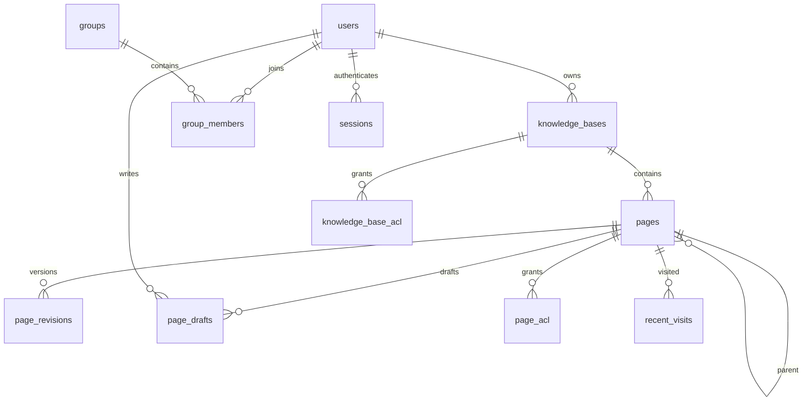

# 首版决策记录（T01、T03）

状态：设计基线；业务实现及验收按 TASK_PLAN 后续任务推进。

## 范围与授权矩阵

沿用 design/WIKI_DESIGN.md 的首版功能和排除项。不增加匿名分享、实时协同、外部身份、AI、OCR、跨库移动、知识库归档/删除、附件手动删除或配额。

| 操作/资源 | 查看者 | 编辑者 | 页面管理员 | 库管理员 | 所有者/系统管理员 |
| --- | --- | --- | --- | --- | --- |
| 当前可见页面、历史、附件 | 是 | 是 | 是 | 按页面有效权限 | 是 |
| 正文、本人草稿、附件上传、创建子页 | 否 | 是 | 是 | 按页面有效权限 | 是 |
| 页面 ACL、移动、删除 | 否 | 否 | 是 | 按页面有效权限 | 是 |
| 库成员和库设置 | 否 | 否 | 否 | 是 | 是 |
| 转让库所有权 | 否 | 否 | 否 | 否 | 是 |
| 账号、组、审计管理 | 否 | 否 | 否 | 否 | 仅系统管理员 |

角色包含下级能力。停用优先于所有特权。独立 ACL 替换继承，用户和组角色取最高值，无 deny。系统管理员访问私密内容必须审计。页面管理员不能管理库成员。

## 生命周期及边界

- 停用所有者前，事务内把其所有库转让给启用账号，否则拒绝；转让同步审计，旧所有者仅保留显式 ACL 权限。
- 不允许停用或降级最后一个启用系统管理员；锁定管理员保护记录再计数。
- 停用、管理员重置密码、本人修改密码均撤销全部已有会话，需重新登录。
- 移动要求源完整子树管理权限，目标父页编辑权限（根位置要求库编辑权限）；同库、无环、最终深度不超过 64。独立后代也必须逐一检查。
- 删除要求完整子树管理权限；预览与执行同样鉴权，不透露隐藏节点数量。执行时重新校验预览使用的结构版本，变化返回 409。
- 标题与正文共同版本化，恢复生成新版本并同时恢复标题正文，不恢复历史权限。
- 草稿 GET/PUT/DELETE 均要求当前编辑权限且只允许本人；最近访问读取时重新过滤当前权限。

## 事务与锁协议

首版采用保守的全局授权屏障行 auth_guard(id=1)：所有需要授权的写事务、撤权事务及账号/组变更先 SELECT FOR UPDATE，再锁用户/组（UUID 升序）、知识库（UUID 升序）、页面（UUID 升序）。首次管理员初始化也使用此屏障。屏障表随身份迁移引入；T09 仅在隔离测试 schema 中建立原型。

使用 READ COMMITTED；获得屏障后从数据库重新读取启用状态、会话及有效 ACL，再变更。组成员删除不能仅锁成员行（不存在行无法锁定）。无跨请求权限缓存。撤权提交后开始的操作必然读取新状态；已执行操作按屏障先后顺序串行完成。吞吐量限制记录为后续压测事项，不提前优化。

读请求使用单条 SQL 或同一只读快照完成授权及数据读取；撤权前已开始的读取可能完成，撤权后新读取必须拒绝。

## 物理模型

主键 UUID，时间 timestamptz。users 增加 is_system_admin 和 status(active/disabled)。group_members 主键(group_id,user_id)。sessions 包含 token_hash 唯一、expires_at、revoked_at。账号不物理删除。

knowledge_base_acl(knowledge_base_id,user_id?,group_id?,role)、page_acl(page_id,user_id?,group_id?,role) 分表；资源及授权对象分别使用真实外键；CHECK 恰一个 subject 非空；role CHECK(viewer/editor/admin)；分别建立资源+user 和资源+group 的部分唯一索引。无多态裸 ID。

pages 唯一(id,knowledge_base_id)，组合外键(parent_id,knowledge_base_id)引用同库页面，CHECK parent_id<>id；环和深度在持锁事务内检查。pages 含 created_by、title、acl_mode(inherit/independent)、acl_version、lock_version、deleted_at、deletion_batch_id。

page_revisions 包含 title、schema_version、body_json、服务端生成 body_text、editor_id、summary、restored_from_revision_id；唯一(page_id,revision_no)和(page_id,id)。先建 pages（current_revision_id 可暂为空），再建 revisions，再 ALTER pages 添加 (id,current_revision_id) → revisions(page_id,id) 的 DEFERRABLE INITIALLY DEFERRED 外键；事务插入页面→初版→设置当前版本。提交时使用延迟约束触发器确保页面有当前版本。应用角色不得 UPDATE/DELETE revisions，保留期清理由独立受控角色完成。

page_drafts 主键(page_id,user_id)，含 title/schema_version/body_json/base_revision_id/draft_version；base_revision 组合外键确保归属页面。PUT 使用 draft_version 比较并递增防乱序。recent_visits 主键(user_id,page_id)，含 visited_at，按时间和 page_id 排序。

附件 pending→ready→清理；页面 active→deleted(batch)→active 或永久清理；会话 active→revoked/expired；版本仅追加；草稿保存/显式删除不生成共享版本。恢复批次只包含该批次页面。

## HTTP 通用约定

业务前缀 /api/v1，健康接口 /health/live、/health/ready。JSON UTF-8，UUID 字符串，UTC RFC3339 时间；请求 ID 由服务端生成并在 X-Request-Id 和响应错误体传递，不信任客户端日志字段。

错误结构 {code,message,request_id,details}：401 UNAUTHENTICATED；403 FORBIDDEN（已可见资源）；404 NOT_FOUND（不存在或不可见统一）；409 REVISION_CONFLICT/ACL_CONFLICT/DRAFT_CONFLICT/STRUCTURE_CONFLICT；422 VALIDATION_ERROR；413 PAYLOAD_TOO_LARGE；429 RATE_LIMITED；503 NOT_READY；500 INTERNAL_ERROR。details 不含私密正文或内部异常。

列表默认 limit=20，上限100，非法值422；游标为版本化 base64url JSON，含排序键和查询条件摘要；非法/条件不匹配游标422。按更新时间 DESC、UUID DESC 稳定排序，搜索额外按标题命中优先；权限过滤必须在 LIMIT 之前。响应 {items,next_cursor}，默认不返回总数。

保存以 base_revision_id 乐观锁；ACL 用 acl_version。创建/上传使用 Idempotency-Key，按操作者+方法+资源+key 唯一存储请求摘要与响应；同 key 异内容409，保留24小时。业务变更与幂等记录在同一事务提交。

补齐接口：GET/PUT/DELETE /pages/{id}/draft；GET /recent-visits、PUT /pages/{id}/visit；GET/POST /admin/users、PATCH /admin/users/{id}、POST /admin/users/{id}/reset-password；GET/POST /admin/groups、PUT/DELETE /admin/groups/{id}/members/{user_id}；POST /knowledge-bases/{id}/transfer-ownership；POST /pages/{id}/move-preview、POST /pages/{id}/delete-preview。全部需要有效会话及对应权限；后续各任务补充 OpenAPI schema。

T10 补充：405 METHOD_NOT_ALLOWED 同样返回标准错误结构；健康检查公开且仅返回 ok/NOT_READY，不返回连接串、路径或 schema 详情。
